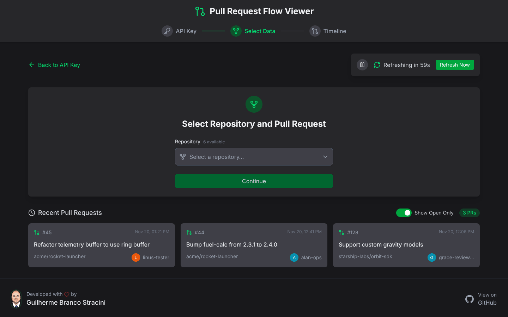
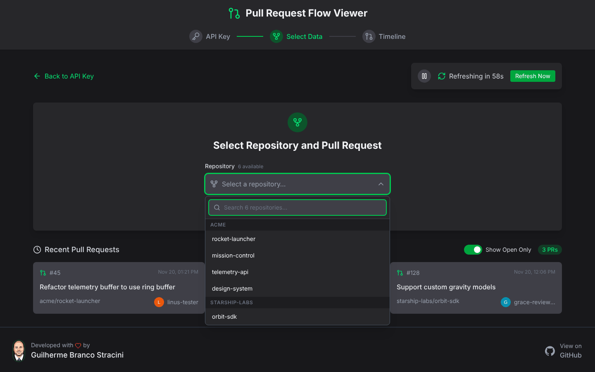
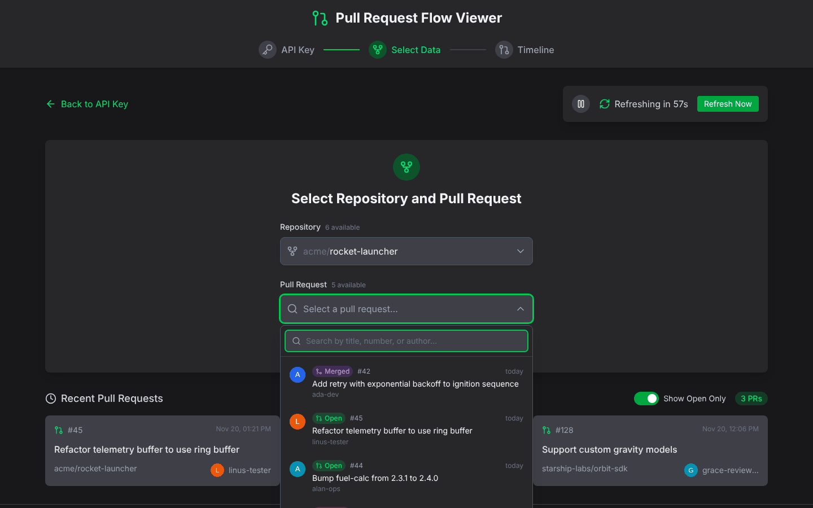
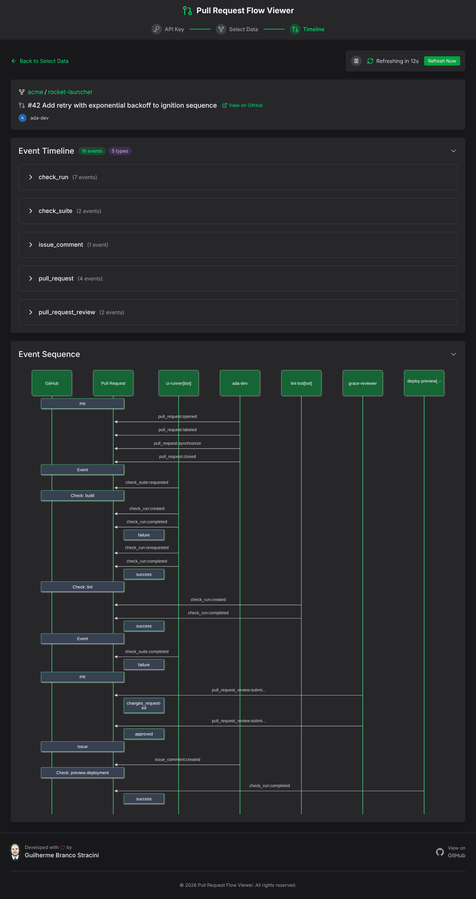
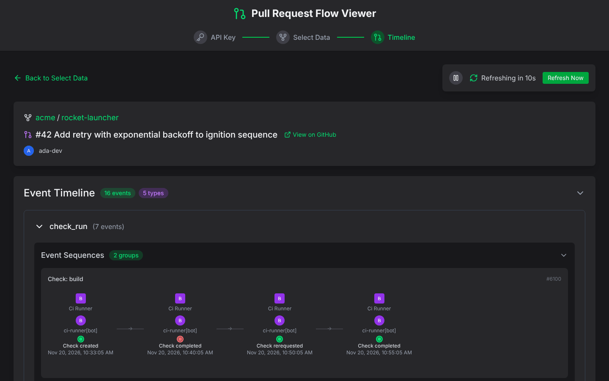
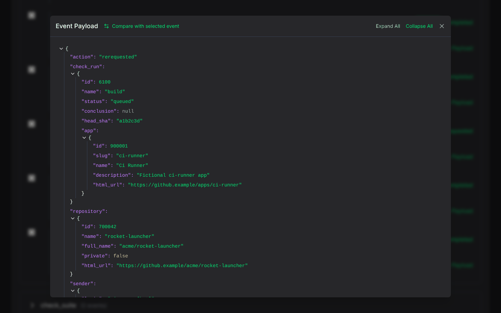
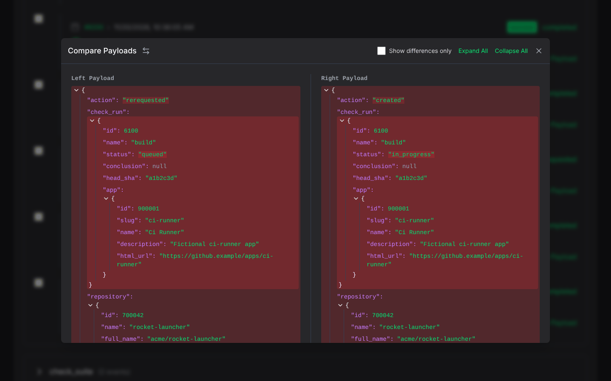
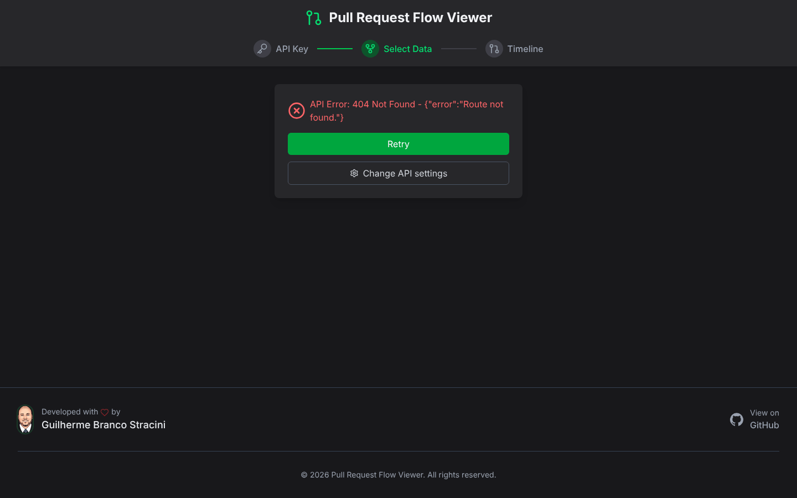
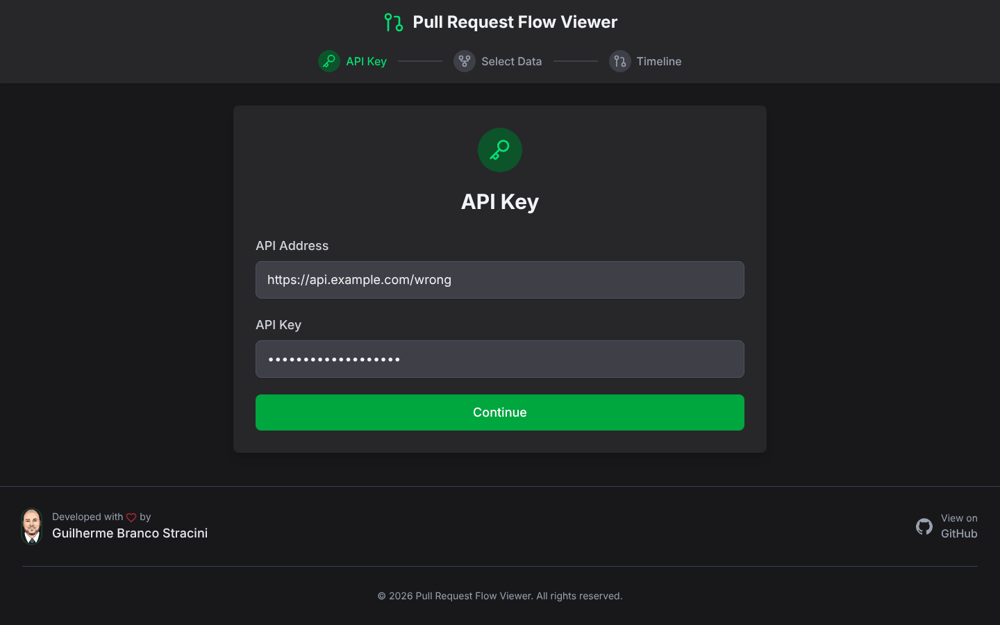

# 🏗️ Pull Request Flow Viewer

A sleek and interactive UI to visualize GitHub webhook events for pull requests! 🚀

🌐 **Live app:** https://guilherme.stracini.com.br/pull-request-ui/

## 🎯 Features

✅ Fetch and display **GitHub webhook events** in a structured table 📊  
✅ Store API key, repository, and PR selection **locally** to persist data 💾  
✅ Beautiful UI with TailwindCSS for an intuitive experience 🎨  
✅ Modular React components for better maintainability 🛠️  
✅ View JSON payloads with syntax highlighting ✨  
✅ Compare payload changes between webhook events 🔄  
✅ Sequence diagram of the events triggered by the most active senders 🧭  
✅ Recover from a wrong API address or key straight from the error screen 🛠️  

## 📸 Preview


> 🧪 The screenshots below use **fictional mock data**: the repositories, pull requests, users and bot apps are invented for illustration.

### 🔑 1. Connect to your API

Enter the base URL of your webhooks API and your API key. Both are stored locally in your browser.


### 📂 2. Pick a repository and pull request

Recent pull requests (last 24 hours) are listed as cards for quick access, with an optional *open only* filter and auto-refresh.



Repositories are grouped by owner and searchable:



Pull requests show their state (open, merged, closed), number, title and author, and can be searched by title, number or author:



### 🕒 3. Explore the event timeline

Events are grouped by type, and the **Event Sequence** diagram shows the events triggered by the five most active senders (events from anyone else appear under GitHub), with check and review outcomes:



Expand an event type to see each lifecycle (e.g. a check run going from *created* → *failure* → *rerequested* → *success*):



### 🔍 4. Inspect and compare payloads

View any webhook payload as a collapsible JSON tree:



Select one event, open another, and compare the two payloads side by side with differences highlighted:



### 🛠️ Recovering from a wrong API address or key

If loading the repositories fails (for example because of a wrong route), **Retry** reloads the page, and **Change API settings** takes you straight back to the API Key step:



For errors like this one, both the saved address and key are kept, so you only need to fix the field that is wrong. If the API rejects the key (401 or 403), the app returns to the API Key step on its own and shows the error; the address is kept but the key is cleared, so you need to enter it again. You can also click **API Key** in the header at any time.



## 🚀 Getting Started

### 1️⃣ Clone the Repository

```sh
git clone https://github.com/guibranco/pull-request-ui.git
cd pull-request-ui
```

### 2️⃣ Install Dependencies

```sh
npm install
```

### 3️⃣ Start the Development Server

```sh
npm run dev
```

## 🛠️ Configuration

On first launch, the app prompts for the **API Address** (base URL of your webhooks API) and your **API Key** on the API Key screen. Both values, along with the selected repository and pull request number, are stored in `localStorage` for convenience. 🎯

## 🏗️ Project Structure

```
📂 src
 ├── 📄 App.tsx
 ├── 📄 index.css
 ├── 📄 main.tsx
 ├── 📄 types.ts
 ├── 📄 vite-env.d.ts
 │
 ├── 📂 components
 │   ├── 📂 layout
 │   │   ├── 📄 Footer.tsx
 │   │   ├── 📄 Header.tsx
 │   │
 │   ├── 📂 select-data
 │   │   ├── 📄 ErrorMessage.tsx
 │   │   ├── 📄 PullRequestSelect.tsx
 │   │   ├── 📄 RecentPullRequests.tsx
 │   │   ├── 📄 RepositorySelect.tsx
 │   │   ├── 📄 SelectForm.tsx
 │   │
 │   └── 📂 timeline
 │       ├── 📄 BulletDiagram.tsx
 │       ├── 📄 EventItem.tsx
 │       ├── 📄 EventList.tsx
 │       ├── 📄 EventTimeline.tsx
 │       ├── 📄 JSONView.tsx
 │       ├── 📄 MermaidDiagram.tsx
 │       ├── 📄 MessageDisplay.tsx
 │       ├── 📄 PayloadCompareModal.tsx
 │       ├── 📄 PayloadModal.tsx
 │       ├── 📄 RefreshButton.tsx
 │
 ├── 📂 services
 │   ├── 📄 api.ts
 │
 ├── 📂 steps
 │   ├── 📄 ApiKeyStep.tsx
 │   ├── 📄 SelectDataStep.tsx
 │   ├── 📄 TimelineViewStep.tsx
 │
 └── 📂 utils
     ├── 📄 avatar.ts
     ├── 📄 events.ts
     ├── 📄 jsonTree.ts
```

## 📡 API Usage

This UI fetches GitHub PR events from:

```bash
GET {API_URL}/recent
GET {API_URL}/repositories/
GET {API_URL}/repositories/{owner}/{repository}/pulls/
GET {API_URL}/repositories/{owner}/{repository}/pulls/{pr_number}/
```

### API Endpoints Used:

- **GET /recent** - Lists all pull requests opened in the last 24 hours.
- **GET /repositories** - Returns a list of repositories with open pull requests.
- **GET /repositories/{owner}/{repository}/pulls** - Fetches all open pull requests for the given owner/org and repository.
- **GET /repositories/{owner}/{repository}/pulls/{pr_number}** - Retrieves all events related to a specific pull request.

## 🤝 Contributing

Feel free to fork, create a PR, or open issues! Your contributions are welcome. 💙

## 📜 License

This project is licensed under the MIT License. 📄
